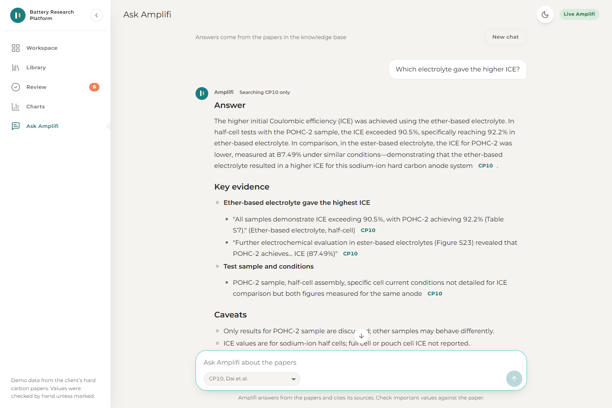
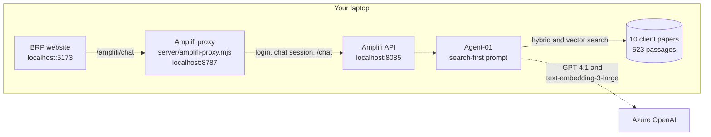
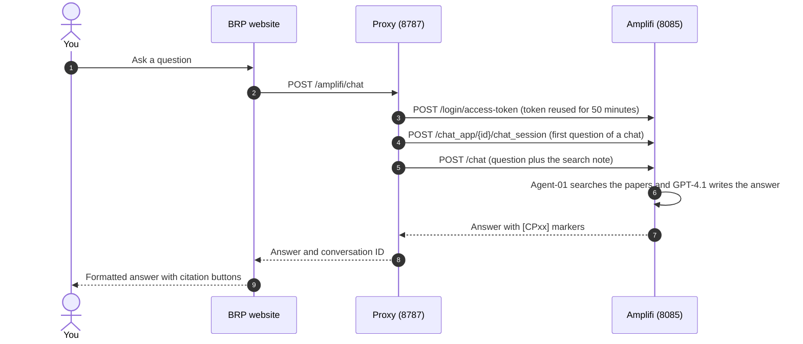
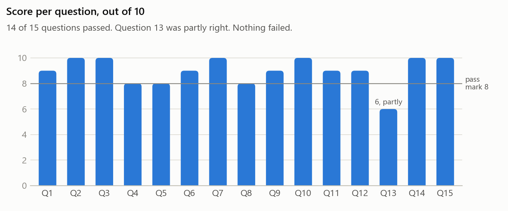

# Battery Research Platform

A React frontend for the Battery Science proof of concept. Researchers explore battery research papers, compare anode and cathode materials, chart the results, and **ask Amplifi questions that are answered from the papers, with citations**.



> **Status, 28 October 2026.** Ask Amplifi is live: it answers from the 10 client papers (CP01 to CP10) through a local Amplifi, and citations such as `[CP10]` open the paper. In a 15-question test it scored 90%, with no invented numbers. All other pages use the bundled sample data.

**Contents:** [Quick start](#quick-start) · [Live Amplifi chat](#live-amplifi-chat) · [How it works](#how-it-works) · [Configuration](#configuration) · [Commands](#commands) · [Do and don't](#do-and-dont) · [Troubleshooting](#troubleshooting) · [Testing](#testing) · [Project structure](#project-structure) · [Known limitations](#known-limitations) · [More documentation](#more-documentation)

## What the app does

| Page | What you can do | Data |
| --- | --- | --- |
| **Workspace** | Find tested anode and cathode pairs, compare materials, spot untested combinations | Sample data |
| **Library** | Search and filter the papers, open a paper's details | Sample data |
| **Review** | Approve or correct values extracted from the papers | Sample data |
| **Charts** | Plot and rank materials by their reported properties | Sample data |
| **Ask Amplifi** | Ask about the papers and get cited answers, with follow-up questions in the same chat | **Live Amplifi** when connected |

The badge in the top bar says which data you are seeing: **Live Amplifi** on the chat page when it is connected, **Demo data** everywhere else.

## Quick start

Needs **Node.js 20 or later**. With no configuration the app runs on sample data and nothing leaves the browser.

```bash
npm ci
npm run dev
```

Open <http://localhost:5173>.

## Live Amplifi chat

You need Amplifi running with the client papers ingested, a chat app whose agent searches them, and an Amplifi login that can use that chat app.

**1. Start Amplifi.** Its API must answer at <http://localhost:8085/health>.

<details>
<summary>Starting local Amplifi on a laptop (lean mode)</summary>

Start Docker Desktop and wait for *Engine running*. Then stop the containers that start by themselves but aren't needed, and start the three that don't start by themselves. The commands work from any folder:

```bash
docker stop extraction-worker grafana prometheus pushgateway flower temporal-ui monitoring-service training-service audio-ingestion-service file-pull-service graph-service
```

```bash
docker start rabbitmq_dev amplifi-vault-1
```

```bash
docker start nginx
```

`docker ps` should then list 12 containers. If <http://localhost:8085/health> returns *502 Bad Gateway*, run `docker restart nginx`.

</details>

**2. Configure this app.** Create `.env` in this folder. It holds no secrets.

```ini
VITE_DATA_MODE=mock
VITE_CHAT_MODE=live
VITE_AMPLIFI_PROXY_URL=/amplifi
AMPLIFI_PROXY_TARGET=http://localhost:8787
VITE_REQUEST_TIMEOUT_MS=120000
```

**3. Configure the proxy.** Copy `.env.amplifi.example` to `.env.amplifi` and fill it in. This file is gitignored and only the proxy reads it, so the login never reaches the browser.

```ini
AMPLIFI_BASE_URL=http://localhost:8085/api/v3
AMPLIFI_EMAIL=<your Amplifi login email>
AMPLIFI_PASSWORD=<your Amplifi login password>
AMPLIFI_CHAT_APP_ID=<the chat app ID from Amplifi's address bar>
```

**4. Start the proxy and the website,** each in its own terminal in this folder:

```bash
npm run amplifi:proxy
```

```bash
npm run dev
```

**5. Check it works.**

1. <http://localhost:8787/amplifi/ping> shows `"ok":true`, so the proxy has logged in to Amplifi.
2. <http://localhost:5173/ask> shows the **Live Amplifi** badge.
3. Pick **CP10** in the paper list and ask *"Which electrolyte gave the higher ICE?"* A good answer gives **92.2%** for the ether-based electrolyte against **87.49%** for the ester-based one, with **CP10** citations.

## How it works



- **The browser never talks to Amplifi.** The Vite dev server forwards `/amplifi` to the proxy, and only the proxy holds the Amplifi login and token.
- **One Amplifi chat per conversation.** The proxy creates an Amplifi chat session for the first question of each chat, so follow-up questions work. **New chat** starts a new one.
- **Every question asks Amplifi to search first.** The proxy adds a short note to each question, and adds *"Answer using only paper CPxx"* when a paper is picked in the list.
- **Answers are rendered safely.** Markdown is shown as headings, lists and tables; raw HTML is never rendered; `[CP01]` markers become buttons that open the paper in the Library.



The browser's side of this contract is in `src/services/amplifiApi.ts`. If Amplifi's API changes, only `src/services/` and the proxy need to change; components never call `fetch` themselves.

## Configuration

**This app (`.env`).** `VITE_` variables are compiled into the browser bundle, so they never hold secrets.

| Variable | Default | Purpose |
| --- | --- | --- |
| `VITE_CHAT_MODE` | same as `VITE_DATA_MODE` | `live` sends Ask Amplifi to the proxy |
| `VITE_DATA_MODE` | `mock` | `mock` uses sample data; `live` calls the platform API for every page (not built yet) |
| `VITE_AMPLIFI_PROXY_URL` | `/amplifi` | Where the browser sends chat requests |
| `VITE_REQUEST_TIMEOUT_MS` | `30000` | Request timeout; use `120000` with live chat |
| `VITE_ROUTER_MODE` | `browser` | `browser`, `hash` (static hosting) or `memory` (embedded demos) |
| `AMPLIFI_PROXY_TARGET` | not set | Dev server only: where `/amplifi` is forwarded, normally `http://localhost:8787` |

`.env.example` also has `VITE_PLATFORM_API_BASE` and `VITE_MAX_UPLOAD_MB`, which matter only for fully live mode and uploads.

**The proxy (`.env.amplifi`).**

| Variable | Required | Purpose |
| --- | --- | --- |
| `AMPLIFI_BASE_URL` | Yes | Amplifi API base, including `/api/v3` |
| `AMPLIFI_EMAIL`, `AMPLIFI_PASSWORD` | Yes | The Amplifi login |
| `AMPLIFI_CHAT_APP_ID` | Yes | The chat app to ask |
| `PORT` | No | Proxy port, default `8787` |
| `AMPLIFI_TIMEOUT_MS` | No | Timeout for each Amplifi call, default `120000` |

## Commands

| Command | What it does |
| --- | --- |
| `npm run dev` | Development server with hot reload at <http://localhost:5173> |
| `npm run amplifi:proxy` | Starts the Amplifi proxy at <http://localhost:8787> |
| `npm test` | Runs all tests once (`npm run test:watch` keeps them running) |
| `npm run lint` | ESLint, including the React hooks rules |
| `npm run typecheck` | TypeScript only |
| `npm run build` | Type check, then a production build into `dist/` |
| `npm run build:standalone` | One self-contained HTML file in `dist-standalone/`, for sharing a demo |

## Do and don't

**Do**

- Keep the Amplifi login only in `.env.amplifi`.
- Restart the proxy after changing `.env.amplifi` or `server/amplifi-proxy.mjs`, and restart `npm run dev` after changing `.env`. Both read their settings only when they start.
- Click **New chat** before each test question. Amplifi remembers the whole chat, so earlier answers can affect later ones.
- Ask about one or two papers at a time, and pick papers CP01 to CP10 only. Those are the papers loaded in Amplifi.
- Keep the agent's prompt search-first, with no answers written into the prompt.
- Check important numbers against the paper. The citation buttons open it.

**Don't**

- Don't put secrets in `VITE_` variables; anyone using the app can read them.
- Don't commit `.env` or `.env.amplifi`. Both are gitignored; keep it that way.
- Don't call Amplifi from the browser or from components. Always go through `src/services/` and the proxy.
- Don't run all of Amplifi's containers on a laptop; on a 14 GB laptop Docker froze. Use the lean set above.
- Don't share one running proxy widely. Everyone who uses it asks through the same Amplifi account.

## Troubleshooting

| What you see | What to do |
| --- | --- |
| Ping says *Amplifi login failed (HTTP 502)* | nginx has lost track of Amplifi's API. Run `docker restart nginx`. |
| Ping says *Amplifi login failed (HTTP 400)* or *(HTTP 401)* | Fix the email or password in `.env.amplifi`, then restart the proxy. |
| *Couldn't reach Amplifi* or *error 500* in the chat | The proxy isn't running, or `AMPLIFI_PROXY_TARGET` doesn't match its port. |
| Answers are labelled as demo answers | Add `VITE_CHAT_MODE=live` to `.env` and restart `npm run dev`. |
| *Took too long* (HTTP 504) | Amplifi's nginx gives up after 60 seconds. Ask a narrower question, or point `AMPLIFI_BASE_URL` at `http://localhost:8000/api/v3` to skip nginx. |
| *Port 8787 (or 5173) is already in use* | An earlier proxy or website is still running in another terminal. Close it. |
| `docker` says it can't connect | Docker Desktop isn't running yet. Start it and wait for *Engine running*. |

## Testing

`npm test` runs 74 tests across nine files:

- **Domain logic:** filters, comparisons, chart maths, review rules, citations and the Markdown conversion of Amplifi answers.
- **Services:** HTTP error handling, response validation, and the proxy contract, including a check that the browser never sends credentials.
- **Whole-app flows:** the Library, Review, uploads and Ask Amplifi, including follow-ups, the paper filter and the live badge.

**Answer quality.** On 28 October we asked Amplifi 15 questions through this app and scored each answer against the original papers. It scored 135 of 150 points (90%): 14 answers passed, 1 was partly right, and every number was in the paper it cited.



## Project structure

```text
server/amplifi-proxy.mjs   Server-side proxy between the browser and Amplifi (Node built-ins only)
src/
  services/                Backend layer: HTTP client, validation, demo and live adapters
  state/                   React context: data, view state, chat, uploads, dialogs, toasts
  domain/                  Pure logic: filters, chart maths, review rules, citations, Markdown
  components/              Presentational components, grouped by area (chat, charts, tables, ...)
  pages/                   One folder per route
  data/                    Sample data, used only in demo mode
  types/  hooks/  styles/  test/
docs/                      Integration notes, Amplifi findings and images
scripts/                   Standalone HTML build
```

Built with React 18, TypeScript, Vite, React Router, CSS Modules and Vitest. Chat answers use `react-markdown` and `remark-gfm`; the charts are hand-written SVG. Every page was checked with axe-core for WCAG 2 A and AA in light and dark themes.

## Known limitations

- **Only Ask Amplifi is live.** The other pages use sample data, and *Find with Amplifi* gives a demo result.
- **Only the 10 client papers are in Amplifi.** The paper list also shows the 27 Theme A papers, which aren't loaded yet.
- **Questions across several papers can miss a paper.** The agent runs one search rather than one per paper.
- **Some citations aren't clickable.** When the agent writes extra words inside the brackets, such as `[CP01, laboratory measurement]`, the citation shows as plain text. About half the citations in the test looked like this.
- **Answers vary between runs.** This Amplifi version doesn't pass the agent's temperature setting to the model.
- **No streaming.** The whole answer arrives at once, usually after 15 to 25 seconds.

## More documentation

| Document | Contents |
| --- | --- |
| [docs/how-amplifi-works.pdf](docs/how-amplifi-works.pdf) | A 10-page visual explainer of Amplifi: ingestion, agents, chat and API access |
| [docs/amplifi-api-notes.md](docs/amplifi-api-notes.md) | Amplifi's endpoints, authentication, response shapes and limits, from its code |
| [docs/AMPLIFI_GETTING_STARTED.md](docs/AMPLIFI_GETTING_STARTED.md) | Step-by-step plan for running this frontend on Amplifi |
| [docs/AMPLIFI_WIRING_BRIEF.md](docs/AMPLIFI_WIRING_BRIEF.md) | The wider integration brief, including the other pages |
| [docs/INTEGRATION.md](docs/INTEGRATION.md) | The platform REST API contract for fully live mode |
| [docs/MIGRATION.md](docs/MIGRATION.md) | Where each feature of the original single-file prototype now lives |
| [docs/React_Frontend_Handoff.md](docs/React_Frontend_Handoff.md) | Handoff notes for the React frontend |
