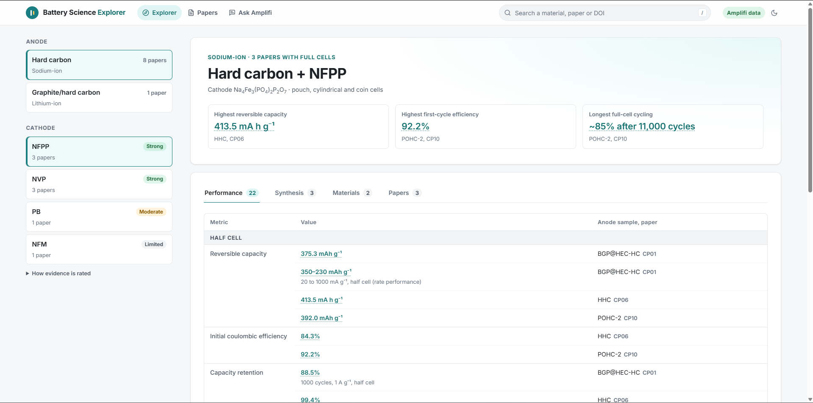
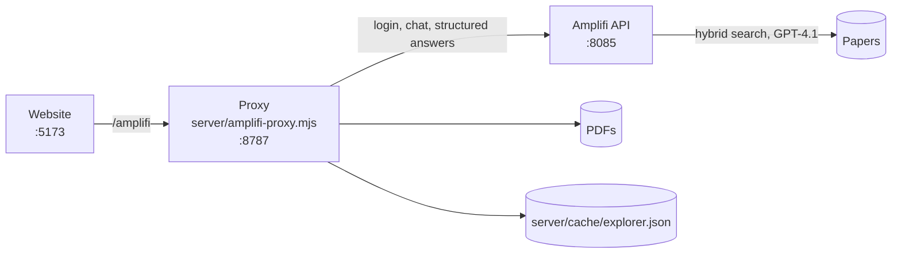

# Battery Science Explorer

A React frontend for the Battery Science proof of concept on Amplifi. It shows what the papers report for each anode and cathode pair, with every value linked to the sentence and PDF page it came from, and lets researchers ask Amplifi about the papers and get cited answers. All data comes live from Amplifi; none is built into the app.



## Features

| Page | What it does |
| --- | --- |
| **Explorer** | Pick an anode, then a cathode it was paired with. See the pair's best results, performance (half and full cells apart), how each anode was made, its materials and the papers behind it |
| **Papers** | Everything Amplifi found in each paper, with its DOI, PDF and five evidence checks |
| **Ask Amplifi** | Questions in plain language, answered with clickable citations. Follow-ups continue the chat. **Export chat** saves a chat as Markdown; each chat's **⋯** menu renames, pins, archives or deletes it |

- Every value opens its source: the quoted sentence and a button that opens the PDF at that page.
- The header search (`/`) finds a material, sample, paper or DOI.
- **Refresh from Amplifi** asks Amplifi about every paper again; the page keeps the current data until the new data is checked.

## Running it

Needs Node.js 20+, Python 3.10+ with `pymupdf` (for refreshing data), and Amplifi with the papers ingested.

**1. Start Amplifi** so that <http://localhost:8085/health> answers. On a laptop, use the lean set of containers:

```bash
docker stop extraction-worker grafana prometheus pushgateway flower temporal-ui monitoring-service training-service audio-ingestion-service file-pull-service graph-service
```

```bash
docker start rabbitmq_dev amplifi-vault-1
```

```bash
docker start nginx
```

**2. Configure.** Create `.env` (no secrets) and `.env.amplifi` (from `.env.amplifi.example`; gitignored, read only by the proxy):

```ini
# .env
VITE_AMPLIFI_PROXY_URL=/amplifi
AMPLIFI_PROXY_TARGET=http://localhost:8787
VITE_AMPLIFI_PAPERS=CP01,CP02,CP03,CP04,CP05,CP06,CP07,CP08,CP09,CP10
```

```ini
# .env.amplifi
AMPLIFI_BASE_URL=http://localhost:8085/api/v3
AMPLIFI_EMAIL=<login email>
AMPLIFI_PASSWORD=<login password>
AMPLIFI_CHAT_APP_ID=<chat app ID>
AMPLIFI_WORKSPACE_ID=<workspace ID>
AMPLIFI_AGENT_ID=<agent ID>
AMPLIFI_PAPERS_DIR=<folder with the papers' PDFs>
```

**3. Start the proxy and the website,** each in its own terminal:

```bash
npm ci
npm run amplifi:proxy
```

```bash
npm run dev
```

**4. Check.** <http://localhost:8787/amplifi/ping> shows `"ok":true`, and <http://localhost:5173> opens the Explorer. The first time, click **Extract the papers with Amplifi** (several minutes).

## How it works



- **The browser never talks to Amplifi.** Only the proxy holds the login; components call `src/services/`, never `fetch`.
- **Chat:** each question goes to Amplifi's chat app with a note to search the papers first, plus *"Answer using only paper CPxx"* when a paper is picked. Chats are kept in the browser (up to 50; pinned ones are never dropped).
- **Explorer data:** a refresh asks Amplifi three structured questions per paper (`scripts/explorer/extract.py`), then `build_data.py` keeps a value only if its quote is on a page of the PDF and its numbers are in the quote. That page is the one the app opens. The result is cached in `server/cache/explorer.json`.
- **Evidence ratings:** *strong* is two or more papers; *moderate* one paper with a pouch or cylindrical cell; *limited* one paper with coin cells only.

## Commands

| Command | What it does |
| --- | --- |
| `npm run dev` | Website at <http://localhost:5173> |
| `npm run amplifi:proxy` | Proxy at <http://localhost:8787> |
| `npm test` | All tests (99) |
| `npm run lint` / `npm run typecheck` | ESLint / TypeScript |
| `npm run build` | Production build into `dist/` |

## Troubleshooting

| Problem | Fix |
| --- | --- |
| Ping says *Amplifi login failed (HTTP 502)*, or health shows *502* | `docker restart nginx` |
| Ping says *HTTP 400/401* | Fix the login in `.env.amplifi`, restart the proxy |
| *Couldn't load Amplifi's data* or *error 500* | The proxy isn't running |
| *Port 8787 (or 5173) is already in use* | An earlier proxy or website is still running; stop it |
| *Took too long* | nginx stops at 60 s; ask a narrower question |
| Refresh fails with *No module named 'pymupdf'* | `pip install pymupdf`, restart the proxy |

## Known limitations

- Answers take 15–40 s and vary between runs. Questions across many papers can miss one.
- The chat cites papers, not pages: Amplifi stores most passages as page 1. The Explorer's pages come from the PDF check.
- Chats, pins and archives live in one browser, not in Amplifi.
- The Explorer's data is as fresh as the last refresh.

## Project structure

```text
server/            Proxy (Node built-ins only); cache/ holds the checked data (gitignored)
scripts/explorer/  Asks Amplifi about each paper and checks the answers against the PDFs
src/pages/         Explorer, Papers, Ask Amplifi
src/components/    Layout, evidence, chat, common UI
src/domain/        Pure logic: the Explorer's model, search, citations, chat export
src/services/      HTTP clients for the proxy
src/state/         React context: data, chats, dialogs, toasts
src/test/          Whole-app tests and recorded fixtures
docs/              Amplifi API notes and images
```

Built with React 18, TypeScript, Vite, React Router, CSS Modules and Vitest.
