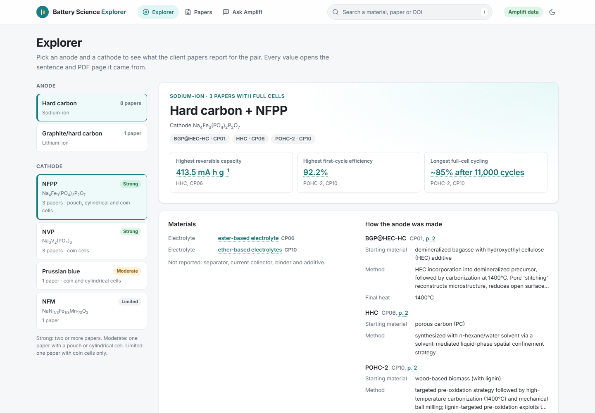
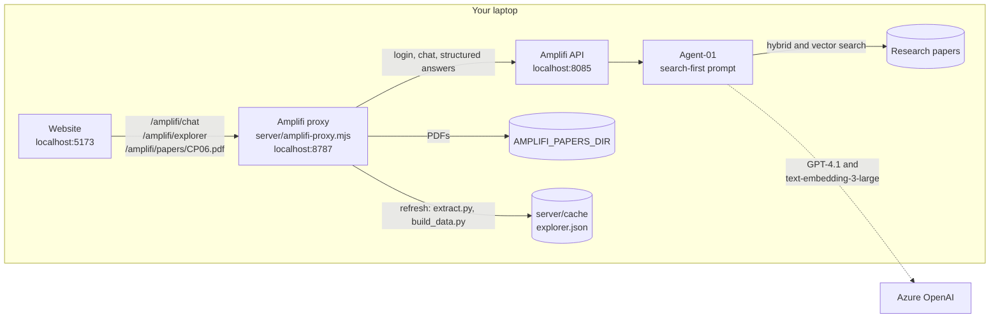
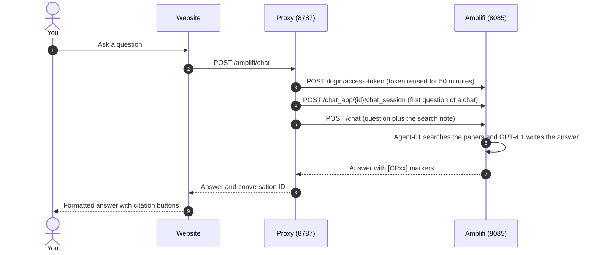

# Battery Science Explorer

A React frontend for the Battery Science proof of concept on Amplifi. It shows **what the papers report for each anode and cathode pair, with every value linked to the sentence and PDF page it came from**, and lets researchers **ask Amplifi about the papers and get cited answers**. Everything it shows comes live from Amplifi; no data is built into the app.



> **Status, 30 October 2026.** Three pages: **Explorer**, **Papers** and **Ask Amplifi**, all fed live by Amplifi through the proxy. The Explorer and Papers show Amplifi's answers about each paper, one structured question per paper, keeping only the values whose sentence is found on the PDF page; **Refresh from Amplifi** asks again. Ask Amplifi sends every question to Amplifi: in a 15-question test on 28 October it scored 91%, with no invented numbers.

**Contents:** [What the app does](#what-the-app-does) · [Quick start](#quick-start) · [Running with Amplifi](#running-with-amplifi) · [The Explorer's data](#the-explorers-data) · [How it works](#how-it-works) · [Configuration](#configuration) · [Commands](#commands) · [Do and don't](#do-and-dont) · [Troubleshooting](#troubleshooting) · [Testing](#testing) · [Project structure](#project-structure) · [Known limitations](#known-limitations) · [More documentation](#more-documentation)

## What the app does

| Page | What you can do |
| --- | --- |
| **Explorer** | Pick an anode and a cathode it has been paired with. See the pair's best results at a glance, then its performance (half-cell and full-cell results apart), how each anode was made, its materials and the papers behind it, one tab at a time |
| **Papers** | Open any paper Amplifi has read to see everything it found, one tab at a time: performance, synthesis, full cells and materials, with the paper's DOI and PDF. Papers without a full cell, such as CP04, and the CP08 review are here too |
| **Ask Amplifi** | Ask about the papers in plain language and get answers with clickable citations, with follow-up questions in the same chat. Previous chats stay in a list and can be opened again |

- **Every value opens its source:** the sentence it was copied from, with the value highlighted, and a button that opens the PDF at that page.
- **The search in the header** finds a material, a sample, a paper or a DOI. Press `/` to jump to it.
- **The Explorer keeps the pair in the address,** for example `/explore?anode=sodium-ion-hard-carbon&cathode=NVP`, so a pair can be shared as a link and Back works.
- **Refresh from Amplifi,** under the Explorer and Papers, asks Amplifi about every paper again. The page keeps showing the current data, with a progress bar, until the new data is checked and ready.
- **The badge** says what you're seeing: **Amplifi data** once Amplifi's checked answers have loaded, **No data yet** before the first extraction, **Data unavailable** when the proxy can't be reached, and **Live Amplifi** in the chat.

## Quick start

Needs **Node.js 20 or later**.

```bash
npm ci
npm run dev
```

Open <http://localhost:5173>. Everything the app shows comes from Amplifi through the proxy, so set it up as in [Running with Amplifi](#running-with-amplifi). Without the proxy, the pages say they couldn't load Amplifi's data.

## Running with Amplifi

You need Amplifi running with the papers ingested, a chat app whose agent searches them, and an Amplifi login that can use that chat app.

**1. Start Amplifi.** Its API must answer at <http://localhost:8085/health>.

<details>
<summary>Starting local Amplifi on a laptop (lean mode)</summary>

Start Docker Desktop and wait for *Engine running*. Then stop the containers that start by themselves but aren't needed, and start the three that don't start by themselves. The commands work from any folder:

```bash
docker stop extraction-worker grafana prometheus pushgateway flower temporal-ui monitoring-service training-service audio-ingestion-service file-pull-service graph-service
```

```bash
docker start rabbitmq_dev amplifi-vault-1
```

```bash
docker start nginx
```

`docker ps` should then list 12 containers. If <http://localhost:8085/health> returns *502 Bad Gateway*, run `docker restart nginx`.

</details>

**2. Configure this app.** Create `.env` in this folder. It holds no secrets.

```ini
VITE_AMPLIFI_PROXY_URL=/amplifi
AMPLIFI_PROXY_TARGET=http://localhost:8787
VITE_REQUEST_TIMEOUT_MS=120000
VITE_AMPLIFI_PAPERS=CP01,CP02,CP03,CP04,CP05,CP06,CP07,CP08,CP09,CP10
```

`VITE_AMPLIFI_PAPERS` lists the papers loaded in Amplifi, so the chat offers only those.

**3. Configure the proxy.** Copy `.env.amplifi.example` to `.env.amplifi` and fill it in. This file is gitignored and only the proxy reads it, so the login never reaches the browser.

```ini
AMPLIFI_BASE_URL=http://localhost:8085/api/v3
AMPLIFI_EMAIL=<your Amplifi login email>
AMPLIFI_PASSWORD=<your Amplifi login password>
AMPLIFI_CHAT_APP_ID=<the chat app ID from Amplifi's address bar>
AMPLIFI_WORKSPACE_ID=<the workspace ID, for structured answers>
AMPLIFI_AGENT_ID=<the agent ID, for structured answers>
AMPLIFI_PAPERS_DIR=<the folder with the papers' PDFs>
```

**4. Start the proxy and the website,** each in its own terminal in this folder:

```bash
npm run amplifi:proxy
```

```bash
npm run dev
```

**5. Check it works.**

1. <http://localhost:8787/amplifi/ping> shows `"ok":true` (the proxy has logged in) and `"structured":true`.
2. Open <http://localhost:5173>. The first time, the Explorer says **No data from Amplifi yet**. This doesn't mean the papers are missing from Amplifi: the Explorer just hasn't asked about them yet. Click **Extract the papers with Amplifi**: the proxy asks Amplifi two questions per paper and checks every answer against the PDF. This takes several minutes, and the page shows how far it has got.
3. When it's done, the badge says **Amplifi data**. Click a value, then **Open the PDF at page …**. The paper opens at that page.
4. On <http://localhost:5173/ask>, pick **CP10** in the chat's paper list and ask *"Which electrolyte gave the higher ICE?"* A good answer gives **92.2%** for the ether-based electrolyte against **87.49%** for the ester-based one, with **CP10** citations.

## The Explorer's data

Amplifi reads the papers and the proxy checks what it says. The proxy keeps the latest checked result in `server/cache/explorer.json` (gitignored) and serves it at `GET /amplifi/explorer`, so the Explorer and Papers load at once and show the same data until the next refresh.

**Refresh from Amplifi** (`POST /amplifi/explorer/refresh`) runs three steps on the proxy, and `GET /amplifi/explorer/status` reports how far it has got:

1. `scripts/explorer/extract.py` asks Amplifi one structured question per paper in `AMPLIFI_PAPERS_DIR`, through the proxy's `/amplifi/structured` route, using the JSON Schema in `scripts/explorer/paper-schema.json`: the paper's title, authors, journal, year and DOI, its anode samples and how they were made, its full cells, materials and performance. Naming the paper's file in the question (`question.txt`) is what makes the agent search the right paper; questions about all the papers at once miss or invent some.
2. It asks each paper once more, only about its full cells (`question-fullcells.txt`), because the first answer sometimes misses one.
3. `scripts/explorer/build_data.py` checks every value against its PDF. A value is shown only when its quote is on a page of the PDF and its numbers are in the quote; that page is the one the app opens (Amplifi's own page numbers are wrong). Amplifi often joins passages with "...": each passage is checked on its own, and only the passages found in the PDF are shown. Fields the quote doesn't support, such as a guessed temperature, are cleared, and a paper's title, authors, journal, year and DOI are shown only when the PDF contains them. Cathodes are grouped across papers by the formula the papers give, and named by the short name Amplifi read in them.

Each refresh keeps Amplifi's answers in `server/cache/answers/<time>`. Each paper then uses whichever of this refresh's answers and the previous refresh's has more checked values, so a paper Amplifi can't answer this time keeps its last answers.

**Checking a refresh.** The PDFs pair hard carbon with NFPP (CP01, CP06, CP10), NVP (CP03, CP07, CP09), Prussian blue (CP05) and NFM (CP07), and CP02's graphite/hard carbon with NCM523. CP04 tests its anodes in half cells only, and CP08 is a review. Amplifi may name a cathode by its short name or formula, such as PB for Prussian blue. Control samples, such as CP02's pure graphite anode, aren't offered as anodes.

**Running the steps by hand** needs Python 3.10 or later with `pip install pymupdf`, and the proxy running with structured answers on:

```bash
python scripts/explorer/extract.py <pdf folder> server/cache/answers/manual/main CP01 CP02 CP03
```

```bash
python scripts/explorer/extract.py <pdf folder> server/cache/answers/manual/cells CP01 CP02 CP03 --question scripts/explorer/question-fullcells.txt
```

```bash
python scripts/explorer/build_data.py <pdf folder> server/cache/answers/manual/main --cells server/cache/answers/manual/cells
```

A question that passes nginx's 60-second limit is asked up to three times; long papers may need `AMPLIFI_BASE_URL` pointed at `http://localhost:8000/api/v3`.

**Evidence rules**, shown on the page. Cathodes are ranked by the number of papers, then by pouch or cylindrical cells: *strong* is two or more papers, *moderate* one paper with a pouch or cylindrical cell, *limited* one paper with coin cells only. Each paper shows how many of five plain checks it passes, and which it misses: DOI found in the PDF, full cell tested, pouch or cylindrical cell, 1,000 or more cycles, and 5 or more checked values.

## How it works



- **The browser never talks to Amplifi.** The Vite dev server forwards `/amplifi` to the proxy, and only the proxy holds the Amplifi login and token.
- **One Amplifi chat per conversation.** The proxy creates an Amplifi chat session for the first question of each chat, so follow-up questions work. **New chat** starts a new one; the earlier chats stay under **Previous chats** (kept in this browser, up to 50), and a reopened chat continues its own Amplifi conversation.
- **Every question asks Amplifi to search first.** The proxy adds a short note to each question, and adds *"Answer using only paper CPxx"* when a paper is picked in the list.
- **Structured answers.** `POST /amplifi/structured` takes `{ question, schema }`, where `schema` is a JSON Schema, and returns `{ data }` in that shape. The proxy sends it to Amplifi's `/chat/upload` with `output_schema`. The extraction scripts use it.
- **Answers are rendered safely.** Markdown is shown as headings, lists and tables; raw HTML is never rendered; citation markers become buttons that open the paper, including ones with a note such as `[CP01, laboratory measurement]`.



The browser's side of these contracts is in `src/services/amplifiApi.ts` (the chat) and `src/services/explorerApi.ts` (the Explorer's data). If Amplifi's API changes, only `src/services/` and the proxy need to change; components never call `fetch` themselves.

## Configuration

**This app (`.env`).** `VITE_` variables are compiled into the browser bundle, so they never hold secrets.

| Variable | Default | Purpose |
| --- | --- | --- |
| `VITE_AMPLIFI_PROXY_URL` | `/amplifi` | Where the browser asks for chat answers and the Explorer's data, and opens PDFs |
| `VITE_AMPLIFI_PAPERS` | every paper | IDs of the papers loaded in Amplifi, comma-separated. Only these appear in the chat's paper list and on "Ask Amplifi about" buttons |
| `VITE_REQUEST_TIMEOUT_MS` | `120000` | Chat request timeout. Amplifi agent runs can take over a minute |
| `VITE_ROUTER_MODE` | `browser` | `browser`, `hash` (static hosting) or `memory` (embedded demos) |
| `AMPLIFI_PROXY_TARGET` | `http://localhost:8787` | Dev server only: where `/amplifi` is forwarded |

**The proxy (`.env.amplifi`).**

| Variable | Required | Purpose |
| --- | --- | --- |
| `AMPLIFI_BASE_URL` | Yes | Amplifi API base, including `/api/v3` |
| `AMPLIFI_EMAIL`, `AMPLIFI_PASSWORD` | Yes | The Amplifi login |
| `AMPLIFI_CHAT_APP_ID` | Yes | The chat app to ask |
| `AMPLIFI_WORKSPACE_ID`, `AMPLIFI_AGENT_ID` | For structured answers and the refresh | The workspace and agent that `/amplifi/structured` asks. Without them that route and the refresh return 503 |
| `AMPLIFI_PAPERS_DIR` | For PDFs and the refresh | The folder with the papers' PDFs, served at `/amplifi/papers/CP06.pdf`; the refresh reads every paper in it. The PDFs stay on your computer and never go into this repo |
| `AMPLIFI_PYTHON` | No | The Python the refresh runs, default `python`. It needs `pymupdf` |
| `AMPLIFI_CACHE_DIR` | No | Where the refresh keeps Amplifi's answers and the checked data, default `server/cache` |
| `PORT` | No | Proxy port, default `8787` |
| `AMPLIFI_TIMEOUT_MS` | No | Timeout for each Amplifi call, default `120000` |

## Commands

| Command | What it does |
| --- | --- |
| `npm run dev` | Development server with hot reload at <http://localhost:5173> |
| `npm run amplifi:proxy` | Starts the Amplifi proxy at <http://localhost:8787> |
| `npm test` | Runs all tests once (`npm run test:watch` keeps them running) |
| `npm run lint` | ESLint, including the React hooks rules |
| `npm run typecheck` | TypeScript only |
| `npm run build` | Type check, then a production build into `dist/` |
| `npm run build:standalone` | One self-contained HTML file in `dist-standalone/`. It has no data of its own: like the website, it needs the proxy |

## Do and don't

**Do**

- Keep the Amplifi login only in `.env.amplifi`.
- Restart the proxy after changing `.env.amplifi` or `server/amplifi-proxy.mjs`, and restart `npm run dev` after changing `.env`. Both read their settings only when they start.
- Click **New chat** before each test question. Amplifi remembers the whole chat, so earlier answers can affect later ones.
- Ask about one or two papers at a time. Questions across many papers can miss one.
- Keep `VITE_AMPLIFI_PAPERS` in step with the papers loaded in Amplifi.
- Keep the agent's prompt search-first, with no answers written into the prompt.
- Click **Refresh from Amplifi** after the papers or the agent change.

**Don't**

- Don't put secrets in `VITE_` variables; anyone using the app can read them.
- Don't commit `.env` or `.env.amplifi`. Both are gitignored; keep it that way.
- Don't edit `server/cache/explorer.json` by hand. A hand edit skips the check against the PDFs; refresh instead.
- Don't call Amplifi from the browser or from components. Always go through `src/services/` and the proxy.
- Don't run all of Amplifi's containers on a laptop; on a 14 GB laptop Docker froze. Use the lean set above.
- Don't share one running proxy widely. Everyone who uses it asks through the same Amplifi account.

## Troubleshooting

| What you see | What to do |
| --- | --- |
| Ping says *Amplifi login failed (HTTP 502)* | nginx has lost track of Amplifi's API. Run `docker restart nginx`. |
| Ping says *Amplifi login failed (HTTP 400)* or *(HTTP 401)* | Fix the email or password in `.env.amplifi`, then restart the proxy. |
| *Couldn't load Amplifi's data*, *Couldn't reach the Amplifi proxy* or *error 500* | The proxy isn't running, or `AMPLIFI_PROXY_TARGET` doesn't match its port. |
| *No data from Amplifi yet* | Nothing has been extracted for the Explorer yet; the papers are still in Amplifi. Click **Extract the papers with Amplifi**. |
| *The refresh didn't finish: … No module named 'pymupdf'* | Run `pip install pymupdf`, or set `AMPLIFI_PYTHON` in `.env.amplifi` to a Python that has it, then restart the proxy. |
| *Set AMPLIFI_WORKSPACE_ID and AMPLIFI_AGENT_ID … to refresh* | Add both to `.env.amplifi`, then restart the proxy. |
| A refresh reports answers *without an answer* | Amplifi didn't answer some questions in time. Those papers keep their last answers; refresh again later. |
| A PDF opens as *Set AMPLIFI_PAPERS_DIR …* | Add `AMPLIFI_PAPERS_DIR` to `.env.amplifi` and restart the proxy. |
| *Took too long* (HTTP 504) | Amplifi's nginx gives up after 60 seconds. Ask a narrower question, or point `AMPLIFI_BASE_URL` at `http://localhost:8000/api/v3` to skip nginx. |
| *Port 8787 (or 5173) is already in use* | An earlier proxy or website is still running in another terminal. Close it. |
| `docker` says it can't connect | Docker Desktop isn't running yet. Start it and wait for *Engine running*. |

## Testing

`npm test` runs 92 tests across 12 files:

- **Domain logic:** the Explorer's grouping, ranking, evidence checks, headline results and highlighting; the header search; citations and the Markdown conversion of Amplifi answers.
- **Amplifi's recorded answers:** `src/test/fixtures/explorerData.ts`, a copy of the proxy's data used only by the tests. Every checked value has a known paper and a PDF page, and each cathode lists the papers the PDFs show.
- **Services and the proxy:** HTTP error handling and the proxy contract, including a check that the browser never sends credentials; the proxy's structured, PDF and Explorer data routes, run against a stand-in Amplifi.
- **Whole-app flows:** the navigation and search, the Explorer from anode to source, Papers, and Ask Amplifi with follow-ups, the paper filter, citations and the badges; and the data's states: not read yet, refreshing, a failed refresh, and the proxy offline.

**Answer quality.** On 28 October we asked Amplifi 15 questions through this app and scored each answer against the original papers. It scored 137 of 150 points (91%): 14 answers passed, 1 was partly right, and every number was in the paper it cited.


## Project structure

```text
server/amplifi-proxy.mjs   Server-side proxy between the browser and Amplifi (Node built-ins only), and its test
server/cache/              The Explorer's data and Amplifi's answers, kept by the refresh (gitignored)
scripts/explorer/          Asks Amplifi about each paper and checks the answers against the PDFs (Python)
scripts/build-standalone.mjs  Standalone HTML build
src/
  pages/                   Explorer, Papers and Ask Amplifi
  components/              layout (header, search), evidence (values, sources, tables, data status), chat, common
  domain/                  Pure logic: the Explorer's model, search, citations, Markdown, formulae
  services/                HTTP clients for the proxy: the chat and the Explorer's data
  state/                   React context: services, the Explorer's data, chat, dialogs, toasts
  test/                    Whole-app tests, and fixtures/ with the recorded data the tests use
  types/  hooks/  styles/
docs/                      Amplifi notes and images
```

Built with React 18, TypeScript, Vite, React Router, CSS Modules and Vitest, in the Inter typeface, with light and dark themes. Chat answers use `react-markdown` and `remark-gfm`.

## Known limitations

- **The Explorer's data is as fresh as the last refresh,** which takes several minutes. Values that can't be matched to their PDF aren't shown; the page says how many.
- **The PDF opens at the right page,** but the value is highlighted only in the app's source view, not inside the PDF.
- **The Explorer reads only the papers in `AMPLIFI_PAPERS_DIR`.** Ask Amplifi searches the papers loaded in Amplifi.
- **Questions across several papers can miss a paper.** The agent runs one search rather than one per paper.
- **Answers vary between runs,** in the chat and in a refresh. This Amplifi version doesn't pass the agent's temperature setting to the model.
- **No streaming.** The whole answer arrives at once, usually after 15 to 25 seconds.

## More documentation

| Document | Contents |
| --- | --- |
| [docs/how-amplifi-works.pdf](docs/how-amplifi-works.pdf) | A 10-page visual explainer of Amplifi: ingestion, agents, chat and API access |
| [docs/amplifi-api-notes.md](docs/amplifi-api-notes.md) | Amplifi's endpoints, authentication, response shapes and limits, from its code |

The other files in `docs/` describe the earlier, multi-page version of this app (Workspace, Library, Review, Charts and uploads), which this redesign replaced.
